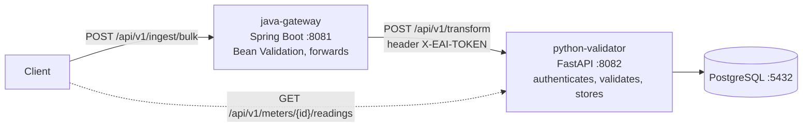
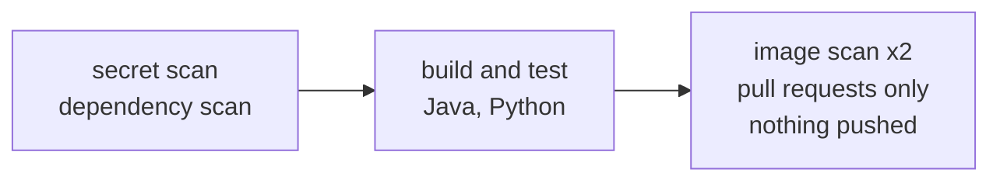

# Backend modernisation and tests — Java, Spring Boot, Python, FastAPI, PostgreSQL, Docker, GitHub Actions, Trivy, Gitleaks

> **Status: work in progress.** This repository is a hands-on proof of concept in which the author brings a long enterprise-integration background up to date with current practice. It starts from a working smart-meter ingestion backend and adds, stage by stage, contract-first APIs, a layered test suite, API security and CI quality gates. The roadmap is below; limitations are stated openly.

The backend receives smart-meter readings through a Java Spring Boot gateway, validates and stores them through a Python FastAPI service, and keeps them in PostgreSQL.



| Service | Folder | Role |
|---|---|---|
| `java-gateway` | `01-java-ingestion-service` | Spring Boot ingestion gateway: validates the request, forwards it to the Python service, and reports a health check that probes the downstream service |
| `python-validator` | `02-python-transformation-api` | FastAPI service: authenticates requests with a shared token, validates and stores readings, serves the read endpoint. The only service that talks to the database |
| PostgreSQL | image `postgres:16-alpine` | Local container |

## How this repository relates to the others

| Repository | What it demonstrates |
|---|---|
| [`enterprise-integration-azure`](https://github.com/nikmar0808/enterprise-integration-azure) | Multi-environment CI and release management: one immutable image promoted through Development, UAT and Production on virtual machines |
| [`eai-azure-poc`](https://github.com/nikmar0808/eai-azure-poc) | The same application on Azure Container Apps, with a Node and a React frontend, a gated delivery pipeline, and the vulnerability and secret remediation exercise |
| `eai-backend-poc` (this one) | The backend's testing, contract-first APIs, API security and CI quality gates |

This repository was created from `eai-azure-poc` at tag `v1.0.0` with a fresh history; [`docs/ORIGIN.md`](docs/ORIGIN.md) records exactly what was carried across and what was left behind.

## Local quickstart

Requires Docker and Docker Compose. No cloud account is needed.

```powershell
# PowerShell, from the repository root
Copy-Item .env.sample .env
# edit .env: set POSTGRES_PASSWORD and API_SECURITY_TOKEN to long random values

docker compose -f docker-compose.dev.yml up --build -d
docker compose -f docker-compose.dev.yml ps
```

```bash
# bash equivalent
cp .env.sample .env      # then edit the two values
docker compose -f docker-compose.dev.yml up --build -d
docker compose -f docker-compose.dev.yml ps
```

| What | Where |
|---|---|
| Gateway health | http://localhost:8081/health |
| Python service health | http://localhost:8082/health |

```bash
curl -X POST http://localhost:8081/api/v1/ingest/bulk \
  -H "Content-Type: application/json" \
  -d '{"meter_id":"MTR-000123","grid_zone":"ZONE-A","readings":[{"timestamp":"2026-01-01T00:00:00Z","kwh_value":12.5}]}'
```

`.env` is ignored by Git.

## Delivery pipeline

One workflow, [`.github/workflows/ci.yml`](.github/workflows/ci.yml). Nothing is deployed from this repository.



- Secret scanning combines TruffleHog (verified and unknown findings) and Gitleaks over the full history, with a project-specific rule held in a repository secret.
- Trivy scans the dependency files and each image. The build fails on CRITICAL and HIGH findings that have a fix. Findings without a fix are ignored as not actionable, and an accepted fixable finding is recorded in [`.trivyignore`](.trivyignore) with an expiry date.
- Every change reaches `develop` through a pull request, and `develop` reaches `main` with a merge commit.

The scan gates were first built and proved in `eai-azure-poc`, where the findings were triaged and fixed rather than only listed (see that repository's README, section "Vulnerability and secret remediation").

## Known limitations

| Limitation | Note |
|---|---|
| The two services share one static token and the gateway has no caller authentication | OAuth2/JWT in Stage 5; production adds mutual TLS or workload identity between services |
| PostgreSQL runs as a local container with a named volume | A production system uses a managed database service with backups |
| No migration tool: the Python service creates its tables when it starts | Planned with the data layer |
| The Python service carries optional Azure Monitor tracing (inactive unless `APPLICATIONINSIGHTS_CONNECTION_STRING` is set), which brings a large dependency set | Redone vendor-neutral, with free tooling, in the observability POC |

## Roadmap

- [x] Stage 0 — repository created, comprehension gate
- [x] Stage 1 — contract-first OpenAPI, linting, breaking-change check
- [x] Stage 1A — code maturity: types, interfaces, response models
- [x] Stage 2 — Java tests (JUnit 5, Mockito, MockMvc, WireMock, JaCoCo)
- [x] Stage 3 — Python tests (pytest, rolling-back database fixture, Schemathesis)
- [ ] Stage 4 — cross-service integration tests in CI
- [ ] Stage 5 — OAuth2/JWT resource server with Keycloak
- [ ] Stage 6 — error model, versioning policy, downstream error mapping
- [ ] Stage 7 — CI gates: coverage, lint, contract, breaking change, end-to-end
- [ ] Stage 8 — architecture document and retrospective

## Documentation

- [`docs/ORIGIN.md`](docs/ORIGIN.md) — where this repository came from
- [`docs/adr/`](docs/adr/README.md) — architecture decision records