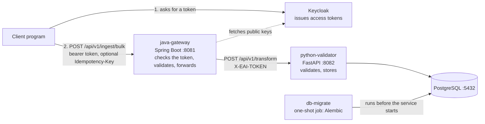
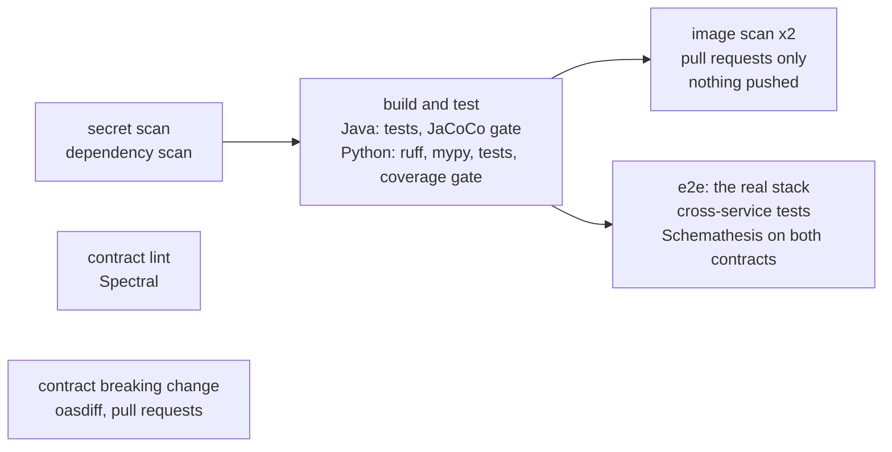

# Backend modernisation and tests: Java, Spring Boot, Python, FastAPI, PostgreSQL, Docker, GitHub Actions, Trivy, Gitleaks

> **Status: finished proof of concept, not production software.** The author used it to bring a long enterprise-integration background up to date with current practice. It starts from a working smart-meter ingestion backend and adds contract-first APIs, a layered test suite, API security, CI quality gates and a managed data layer. It was built on free-tier tools, with AI assistance, and every step was run and checked by the author. Limitations are stated openly below.

The backend receives smart-meter readings through a Java Spring Boot gateway, validates and stores them through a Python FastAPI service, and keeps them in PostgreSQL. Keycloak issues the tokens that callers present to the gateway.



The design is explained in [`docs/ARCHITECTURE.md`](docs/ARCHITECTURE.md).

| Service | Folder | Role |
|---|---|---|
| `java-gateway` | `01-java-ingestion-service` | Spring Boot gateway: verifies the caller's token, validates the request, forwards it, and passes an `Idempotency-Key` on |
| `python-validator` | `02-python-transformation-api` | FastAPI service: validates and stores readings, remembers idempotency keys, serves the read route. The only service that talks to the database |
| `db-migrate` | `02-python-transformation-api` | A one-shot job from the same image: applies Alembic migrations, then exits |
| Keycloak | image `quay.io/keycloak/keycloak` | Local identity provider, with a realm imported from `keycloak/eai-realm.json` |
| PostgreSQL | image `postgres:16-alpine` | Local container |

## How this repository relates to the others

| Repository | What it demonstrates |
|---|---|
| [`enterprise-integration-azure`](https://github.com/nikmar0808/enterprise-integration-azure) | Multi-environment CI and release management: one immutable image promoted through Development, UAT and Production on virtual machines |
| [`eai-azure-poc`](https://github.com/nikmar0808/eai-azure-poc) | The same application on Azure Container Apps, with a Node and a React frontend, a gated delivery pipeline, and the vulnerability and secret remediation exercise |
| `eai-backend-poc` (this one) | The backend's testing, contract-first APIs, API security, CI quality gates and data layer |
| [`db-lab`](https://github.com/nikmar0808/db-lab) | PostgreSQL and MongoDB from Java and Python, on made-up utility data: the learning behind this repository's data layer |

This repository was created from `eai-azure-poc` at tag `v1.0.0` with a fresh history; [`docs/ORIGIN.md`](docs/ORIGIN.md) records exactly what was carried across and what was left behind.

## Local quickstart

Requires Docker with Compose. No cloud account is needed. These commands are for Windows PowerShell, from the repository root.

```powershell
Copy-Item .env.sample .env
# Edit .env: replace the four <replace-...> values with long random letters and digits.

# Put the values in this window's environment, and name the two Compose files once.
Get-Content .env | ForEach-Object { if ($_ -match '^[A-Z_]+=') { $k, $v = $_ -split '=', 2; Set-Item "env:$k" $v } }
$env:COMPOSE_FILE = 'docker-compose.dev.yml;docker-compose.security.yml'

docker compose up -d --build --wait --wait-timeout 300
docker compose ps -a
```

The first build takes a few minutes. `db-migrate` then shows `Exited (0)`, which is correct, and the other four show `healthy`.

```powershell
# Get a token, and send one reading through the gateway.
$token = .\scripts\get-token.ps1
$body = '{"meter_id":"MTR-000123","grid_zone":"ZONE-A","readings":[{"timestamp":"2026-01-01T00:00:00Z","kwh_value":12.5}]}'
Invoke-RestMethod -Method Post -Uri http://127.0.0.1:8081/api/v1/ingest/bulk -ContentType application/json -Body $body -Headers @{ Authorization = "Bearer $token"; 'Idempotency-Key' = 'readme-1' } | ConvertTo-Json

# Read it back from the Python service, which uses the shared token.
Invoke-RestMethod -Uri http://127.0.0.1:8082/api/v1/meters/MTR-000123/readings -Headers @{ 'X-EAI-TOKEN' = $env:API_SECURITY_TOKEN } | ConvertTo-Json

# Remove the stack and its data.
docker compose down -v
```

| What | Where |
|---|---|
| Gateway health | http://127.0.0.1:8081/health |
| Python service health | http://127.0.0.1:8082/health |

`.env` is ignored by Git.

## Database changes

Alembic owns the tables ([ADR-006](docs/adr/ADR-006-alembic-owns-the-schema.md)). The files are in
`02-python-transformation-api/migrations/versions/`; the one-shot Compose service `db-migrate` applies them before
`python-validator` starts. A reading is stored once per meter per moment, and a repeat is ignored and counted; a client that retries sends an
`Idempotency-Key` and gets the first answer ([`docs/api/README.md`](docs/api/README.md)).

## Delivery pipeline

Three workflows in [`.github/workflows/`](.github/workflows/). Nothing is deployed from this repository.



| Workflow | Runs | What it does |
|---|---|---|
| `ci.yml` | every pull request; pushes to `develop` and `feature/**` | the gates in the diagram except the breaking-change check; every job is a required check on `develop` and `main` |
| `contract-check.yml` | every pull request, and when its labels change | compares both contracts with the target branch's versions; a breaking change needs the label `breaking-change-approved` ([`docs/api/README.md`](docs/api/README.md)) |
| `nightly-scan.yml` | every night at 02:13 IST, and by hand | Trivy over the dependency files and both images, rebuilt from `main` ([ADR-012](docs/adr/ADR-012-base-image-policy.md)) |

- Secret scanning combines TruffleHog (verified and unknown findings) and Gitleaks over the full history, with a project-specific rule held in a repository secret.
- Trivy scans the dependency files and each image. The build fails on CRITICAL and HIGH findings that have a fix. Findings without a fix are ignored as not actionable, and an accepted fixable finding is recorded in [`.trivyignore`](.trivyignore) with an expiry date.
- Every change reaches `develop` through a pull request, and `develop` reaches `main` with a merge commit.
- Dependabot proposes dependency, base-image and action updates every week as pull requests into `develop`, which pass the same gates.

The scan gates were first built and proved in `eai-azure-poc`, where the findings were triaged and fixed rather than only listed (see that repository's README, section "Vulnerability and secret remediation").

## Known limitations

| Limitation | Note |
|---|---|
| The gateway and the Python service share one static token | Production adds mutual TLS or workload identity between services |
| The read route is on the Python service, not the gateway | A client that reads needs the shared token. Production puts the route behind the gateway, with a scope of its own |
| PostgreSQL runs as a local container with a named volume | A production system uses a managed database service with backups |
| kWh and voltage are stored as floating-point numbers, and the migration takes a short outage | An exact `numeric` type would need its own migration and API review; expand and contract avoids the outage on a large table (ADR-006) |
| Idempotency keys are kept for ever | Production deletes them on a schedule, after the longest time a client may retry |
| The gateway is on Spring Boot 3.5, past its free support | Library fixes are applied by hand as version overrides until an upgrade to Spring Boot 4, which is a work item of its own |
| The Python service carries optional Azure Monitor tracing (inactive unless `APPLICATIONINSIGHTS_CONNECTION_STRING` is set), which brings a large dependency set | To be redone vendor-neutral, with free tooling |

## What was done

- [x] Repository created, with a recorded baseline of behaviour
- [x] Contract-first OpenAPI, linting, breaking-change check
- [x] Code maturity: types, interfaces, response models
- [x] Java tests (JUnit 5, Mockito, MockMvc, WireMock, JaCoCo)
- [x] Python tests (pytest, rolling-back database fixture, Schemathesis)
- [x] Cross-service integration tests in CI
- [x] OAuth2/JWT resource server with Keycloak
- [x] Error model, versioning policy, downstream error mapping
- [x] CI gates: coverage, lint, contract, breaking change, end-to-end
- [x] Data layer: Alembic, exact moments, readings stored once, idempotency keys, typed models
- [x] Architecture document and retrospective

## Documentation

- [`docs/ARCHITECTURE.md`](docs/ARCHITECTURE.md): the design
- [`docs/api/README.md`](docs/api/README.md): the API contracts and their rules
- [`docs/adr/`](docs/adr/README.md): architecture decision records
- [`docs/RETROSPECTIVE.md`](docs/RETROSPECTIVE.md): what went well and what did not
- [`docs/ORIGIN.md`](docs/ORIGIN.md): where this repository came from