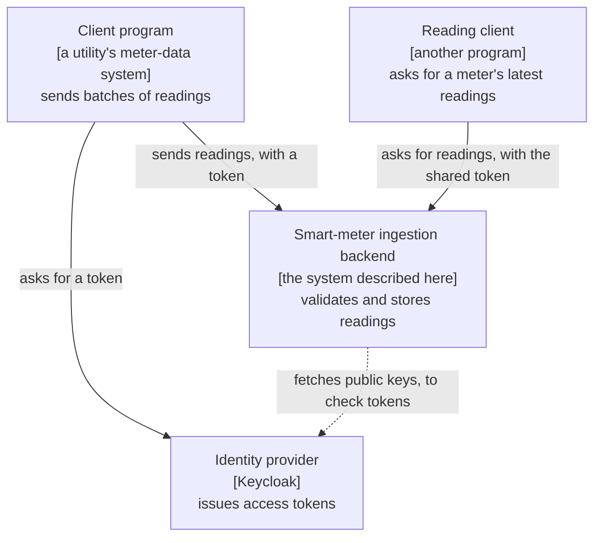
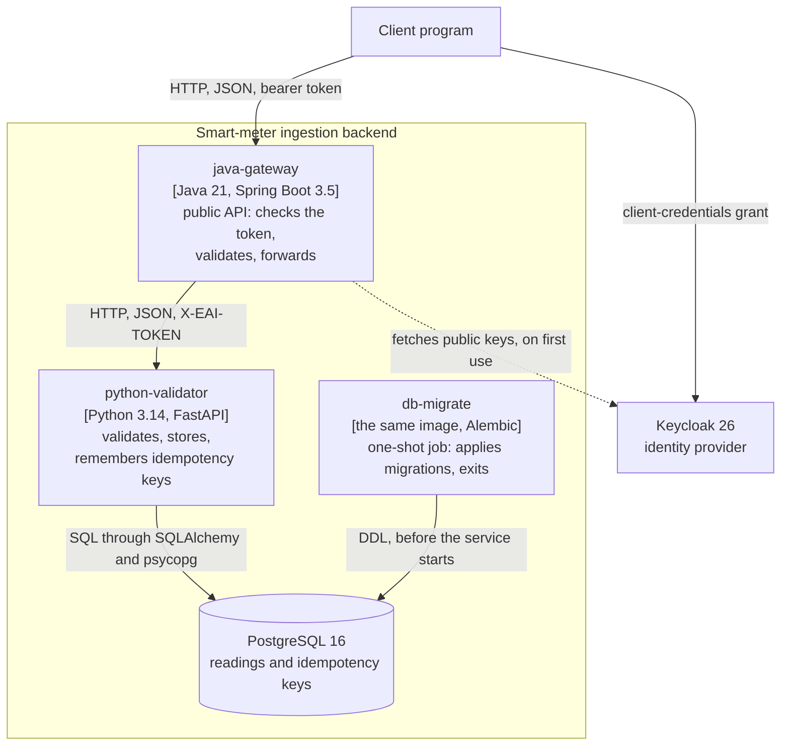
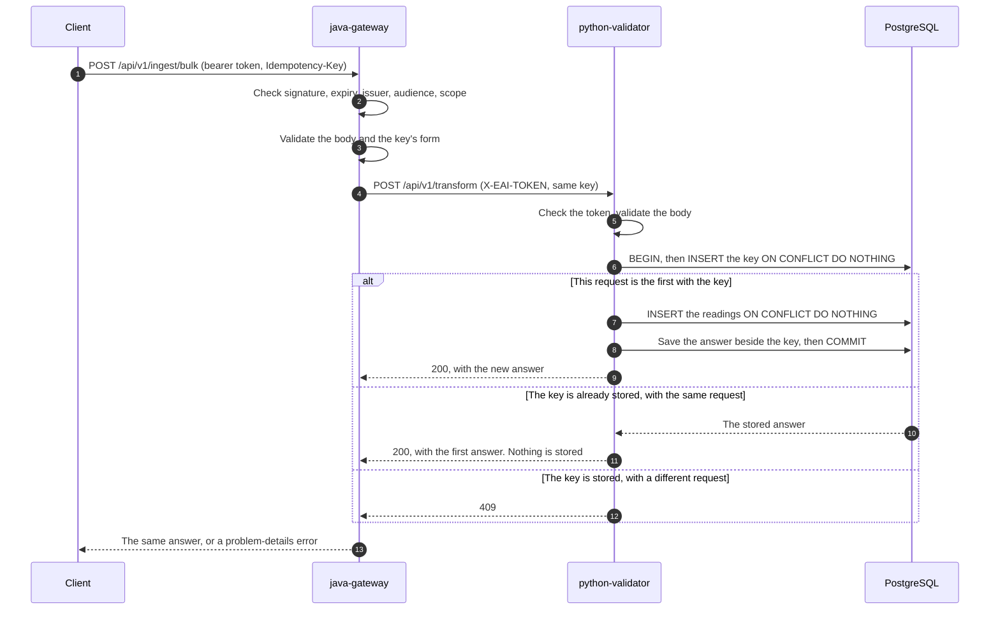
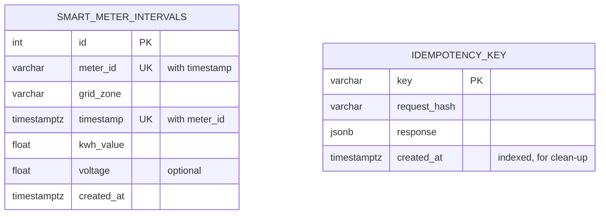
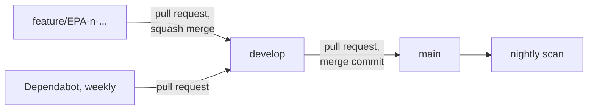

# Architecture

How this backend is built, and why. The diagrams follow the C4 model: each one zooms in one level from the one before.
Decisions are recorded in [`adr/`](adr/README.md), and the API's exact rules in [`api/README.md`](api/README.md). This
document does not repeat them.

## 1. What the system does

A utility's systems send batches of smart-meter readings. The backend checks each batch, stores each reading once, and
answers with a summary. It also serves the latest readings of a meter.

It is a proof of concept, run locally with Docker Compose. Nothing is deployed from this repository. Section 9 says what
a production system would change.

## 2. The system and its surroundings (C4 level 1: context)

Callers are programs, not people, so there is no login page and no user interface.

## 3. The parts that run (C4 level 2: containers)

In C4, a *container* is anything that runs separately and holds code or data. Here each one happens to be a Docker
container too.

| Container | Responsible for | Deliberately not responsible for |
|---|---|---|
| `java-gateway` | Who may call; the shape of a request; turning failures behind it into 502 and 504 | Data: it has no database, and it does not store idempotency keys |
| `python-validator` | The same validation rules again; storing; the idempotency rule | Who the caller is: it trusts the gateway through the shared token |
| `db-migrate` | Bringing the database to the latest migration | Running after it has finished: `restart: "no"` |
| PostgreSQL | Keeping the data, and enforcing the rule of one reading per meter per moment | |
| Keycloak | Issuing signed tokens | Being available for the gateway to start: the gateway fetches keys only when the first token arrives |

**Why two services validate the same rules.** The gateway is the public door, but the Python service can be reached
directly. A test sends thirteen request files to both, and fails if they disagree.

**Start-up order.** PostgreSQL becomes healthy; `db-migrate` runs and exits with 0; `python-validator` starts and becomes
healthy; `java-gateway` starts. A failed migration stops the chain, so the service never runs against the wrong tables.

## 4. Inside each service (C4 level 3: components)

The layers are small, so a table is clearer than a diagram.

| Service | Layer | Holds | Depends on |
|---|---|---|---|
| Gateway | `api` | `IngestionController`, `HealthController`, `ApiExceptionHandler` | `service` |
| Gateway | `api.dto` | Request and response records, with validation annotations | |
| Gateway | `service` | `IngestionService` | The `TransformationGateway` interface, not `RestClient`, so a test can stand in for it |
| Gateway | `client` | `TransformationClient`, the HTTP call to Python | Spring `RestClient` |
| Gateway | `configuration` | Security filter chain, JWT validators, JSON strictness, HTTP client settings | Spring Security, Keycloak's keys |
| Python | `app/api` | Routes, the token check, error handlers | `app/services`, `app/schemas` |
| Python | `app/schemas` | Pydantic models for requests and answers | |
| Python | `app/services` | `store_readings`: the idempotency steps and the insert | `app/database` |
| Python | `app/database` | Engine, sessions, typed table classes | SQLAlchemy, psycopg |
| Python | `migrations/` | Alembic's numbered changes | The table classes, compared by `alembic check` |

C4's fourth level, the code itself, is not drawn: at this size, the code is the better guide.

## 5. Sending readings, step by step

**Why the key is written in the readings' transaction.** Written separately, a crash between the two writes would leave
either a key for work never done, which loses data, or work with no key, which repeats it. In one transaction, both
happen or neither does.

**Two requests with one key at the same moment.** The second `INSERT` of the key waits on the primary key's index until
the first transaction ends. The database does the queueing, and no lock of the application's own is needed.

**Without a key,** the unique rule still protects the data: a repeated reading is skipped and counted in
`duplicates_ignored`.

**When something behind the gateway fails:**

| What happened | The client gets |
|---|---|
| Python rejects, fails, or cannot be reached | 502 |
| No answer in time (connect 5 s, read 30 s) | 504 |
| Python answers 409 (a key was reused) | 409: the client's own mistake, so it is passed on |

The gateway makes one call and never retries. Retrying is the client's decision, and the key makes it safe.

## 6. The data

- **One owner.** Only `python-validator` reads and writes these tables, and only Alembic changes them
  ([ADR-006](adr/ADR-006-alembic-owns-the-schema.md)).
- **Exact moments.** `timestamptz` holds one point in time, whatever the session's time zone is. The API answers in UTC.
- **One reading per meter per moment.** The unique rule's index on `(meter_id, timestamp)` also serves the read route,
  which reads it backwards from a meter's latest entry. On 200,000 rows, that read 20 rows for 20 results, where the old
  index read 1,000 rows and sorted them.
- **The tables are unrelated.** The key table records requests, not readings, so there is no foreign key between them.

## 7. Security

| Hop | Mechanism | Checked by |
|---|---|---|
| Client to Keycloak | Client-credentials grant, with a client secret | Keycloak |
| Client to gateway | Bearer JWT, signed RS256, living 300 s | The gateway: signature, expiry, issuer, audience, then the scope `ingest.write` |
| Gateway to Python | The shared token `X-EAI-TOKEN`, compared in constant time | The Python service |
| Python to PostgreSQL | User name and password from the environment | PostgreSQL |

- **Secrets** come from `.env`, which Git ignores. Two scanners check the whole history on every pull request.
- **Errors reveal nothing.** Every error is an RFC 9457 problem-details body with a fixed sentence: no exception text, no
  SQL and no input values ([ADR-011](adr/ADR-011-problem-details.md)). Logs carry statuses and field names, not values.
- **Closed by default.** Any gateway path without a rule of its own needs a valid token. `/health` is open, because
  Docker's health check carries no token.

The issuer in a token is a name to compare, not an address to call. It stays `http://localhost:8180/realms/eai`, whichever
address the token was fetched through. The gateway fetches keys from `keycloak:8080` inside Compose.

## 8. How a change reaches `main`

Both merges need the same nine required checks:

| Check | Fails when |
|---|---|
| `secret-scan` | TruffleHog or Gitleaks finds a secret anywhere in the history |
| `dependency-scan` | A CRITICAL or HIGH vulnerability with a fix is in a dependency file |
| `contract-lint` | Spectral reports an error or a warning in a contract |
| `contract-breaking-change` | oasdiff finds a change that would break a client, without the approval label |
| `java-build-test` | A Java test fails, or line coverage falls below 99% |
| `python-build-test` | ruff or mypy reports anything, a test fails, or coverage falls below 92% |
| `image-scan` (two images) | A CRITICAL or HIGH vulnerability with a fix is in a built image |
| `e2e` | The real stack fails to start, an end-to-end test fails, or Schemathesis reports a case that breaks a contract |

On 4 November 2026 the suites held 119 Java tests, 125 Python tests and 48 end-to-end tests. The Python tests build their
database with the real migrations, and fail if a table class and the migrations disagree.

## 9. What production would change

| Area | Here | Production alternative |
|---|---|---|
| Running the containers | Docker Compose on one machine | Kubernetes, Azure Container Apps or Amazon ECS, several copies of each service |
| PostgreSQL | One container and a volume | A managed service (Azure Database for PostgreSQL, Amazon RDS), with backups and failover |
| Identity provider | Keycloak in development mode | Microsoft Entra ID, Auth0, Amazon Cognito, or a managed Keycloak |
| Between services | A shared static token | Mutual TLS through a service mesh, or workload identity |
| Public entry | The gateway's port | An API gateway or edge service with TLS and rate limits, in front of the gateway |
| Migrations | A Compose job, under the service's own database account | A pipeline step before deployment, under an owner account; the service may only read and write data |
| Changing a column's type | One step, with a short lock | Expand and contract, across several releases |
| Exact quantities | `Float` | `numeric(12,3)` for energy that is billed |
| Idempotency keys | Kept for ever | A scheduled delete or partitions, with an alert if the job stops |
| Message delivery | One HTTP call, retried by the client | A queue such as Kafka or RabbitMQ when volume or outages justify one |
| Observability | Logs in the console; optional Azure tracing, off by default | OpenTelemetry to a shared backend, with dashboards and alerts |
| Secrets | `.env` | Azure Key Vault, AWS Secrets Manager or HashiCorp Vault |

## 10. Decisions

| ADR | Decision |
|---|---|
| [004](adr/ADR-004-contract-first-openapi.md) | The contracts are written first, and the code conforms to them |
| [005](adr/ADR-005-gateway-oauth2-resource-server.md) | The gateway is an OAuth2 resource server |
| [006](adr/ADR-006-alembic-owns-the-schema.md) | Alembic owns the schema, and migrations run as a separate job |
| [011](adr/ADR-011-problem-details.md) | One error format in both services |
| [012](adr/ADR-012-base-image-policy.md) | Base images by version tag, scanned every night |

The full list, including the repository's history, is in [`adr/README.md`](adr/README.md).